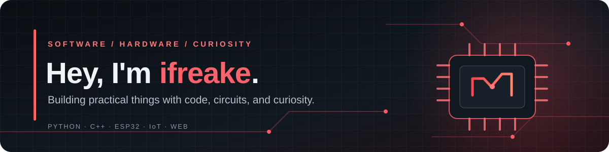

  

  
<strong>Embedded Systems&nbsp; · &nbsp;IoT&nbsp; · &nbsp;Software Development</strong>

  

    <a href="#about-me">About</a> &nbsp;•&nbsp;
    <a href="#toolbox">Toolbox</a> &nbsp;•&nbsp;
    <a href="#featured-projects">Projects</a> &nbsp;•&nbsp;
    <a href="#what-im-exploring">Exploring</a> &nbsp;•&nbsp;
    <a href="#github-activity">Activity</a> &nbsp;•&nbsp;
    <a href="#connect">Connect</a>
  

  

    
    
    
    
    
    
  

---

## About me

Hi! I'm **ifreake** — a developer who enjoys exploring the space where software meets hardware.

I like understanding how things work, experimenting with new ideas, and turning those ideas into practical projects. My interests range from writing code and building small applications to programming microcontrollers, connecting devices, and exploring the fundamentals of IoT.

I don't want to limit myself to one environment. Sometimes the challenge is solving a problem in code; sometimes it's making a circuit work, debugging firmware, or bringing a device and a web interface together. That mix is what keeps development interesting for me.

### A few things about my approach

- **Curiosity first:** I enjoy exploring unfamiliar tools, technologies, and concepts.
- **Learn by building:** I prefer practical experiments and projects over learning only in theory.
- **Understand the details:** I like finding out why something works, not just making it work once.
- **Keep improving:** Clean code, useful documentation, testing, and iteration matter.
- **Build responsibly:** Especially when experimenting with connected devices and network-related features.

---

## Toolbox

The tools and technologies I work with or use in my projects.

<table>
  <tr>
    <td width="50%" valign="top">

### 💻 Programming

  

- **Python** — scripting, automation, and development
- **C++** — embedded programming and firmware
- **JavaScript** — web fundamentals and interactive interfaces

    </td>
    <td width="50%" valign="top">

### 🔌 Embedded & IoT

  
  

- Arduino-based projects
- ESP32 development and experiments
- Sensors, displays, and hardware interfaces
- Firmware structure and device diagnostics

    </td>
  </tr>
  <tr>
    <td width="50%" valign="top">

### 🌐 Web & Interfaces

  

- HTML and CSS
- JavaScript fundamentals
- Local dashboards and device interfaces
- Connecting software interfaces to hardware projects

    </td>
    <td width="50%" valign="top">

### 🛠️ Tools & Workflow

  

- Git and GitHub
- VS Code and PlatformIO
- Linux development environment
- Debugging, documentation, and version control

    </td>
  </tr>
</table>

---

## Featured projects

A selection of projects that represent the areas I enjoy exploring: embedded development, hardware interaction, software, and practical experimentation.

<table>
  <tr>
    <td width="50%" valign="top">

### 🔴 ESP32 CyberLab

An educational embedded lab built around ESP32, bringing together device diagnostics, IoT experiments, and defensive network-related features.

**Highlights**

- Wi-Fi discovery with SSID, RSSI, channel, and authentication information
- SHA-256 hashing experiments
- LittleFS-based event logging
- Local browser dashboard
- Serial command-line interface
- Optional SSD1306 OLED status display

**Built with**

C++ · ESP32 · Arduino · PlatformIO · LittleFS

<a href="https://github.com/ifreake/ESP32-CyberLab/blob/main/README.md">Documentation</a>
&nbsp;·&nbsp;
<a href="https://github.com/ifreake/ESP32-CyberLab">Source code</a>

    </td>
    <td width="50%" valign="top">

### 🎮 Arduino OLED Tetris

A compact, playable Tetris implementation running on Arduino with a 128×64 SSD1306 OLED display and four physical buttons.

**Highlights**

- All seven classic tetromino shapes
- Piece rotation and simple wall-kick handling
- Gravity-based movement and soft drop
- Collision detection and line clearing
- Start and game-over screens
- Lightweight fixed-size data structures

**Built with**

C++ · Arduino · SSD1306 OLED · PlatformIO

<a href="https://github.com/ifreake/Arduino-OLED-Tetris/blob/main/README.md">Documentation</a>
&nbsp;·&nbsp;
<a href="https://github.com/ifreake/Arduino-OLED-Tetris">Source code</a>

    </td>
  </tr>
</table>

### What these projects have in common

Both projects are about making software interact with the physical world. One explores a small game with constrained hardware and a display; the other brings together device features, local interfaces, logging, and embedded experiments.

I enjoy that combination of planning, implementation, testing, and discovering the little details that make a project reliable.

---

## What I'm exploring

These are areas I want to keep learning about and experimenting with. They are learning goals, not claims that every item is already implemented.

### Embedded systems
- Structuring maintainable firmware for microcontrollers
- Working with displays, peripherals, and device interfaces
- Understanding memory constraints and performance
- Improving debugging and hardware-testing workflows

### IoT & security fundamentals
- Reliable communication between connected devices
- MQTT and TLS concepts
- Device identity and message authentication
- Secure update flows and safer device configuration
- Defensive network diagnostics in controlled lab environments

### Software development
- Writing clearer, reusable Python and C++ code
- Building practical tools and interfaces
- Improving project architecture and documentation
- Adding meaningful automated tests where possible

---

## How I like to build

| 01 · Explore | 02 · Build | 03 · Test | 04 · Improve |
|:---:|:---:|:---:|:---:|
| Understand the problem | Turn ideas into code | Debug on real setups | Refine and document |

For me, a project is more than the final result. The experiments, failed attempts, debugging sessions, and small improvements are all part of the process.

---

## GitHub activity

  
  

   

  

   

  

Statistics and contribution visuals are provided by external GitHub README services and may occasionally be unavailable or rate-limited.

---

## Connect

  

  
Have an interesting idea, a project, or something worth experimenting with?

  
Feel free to explore my repositories and connect through GitHub.

---

  <h3>Build with curiosity. Learn by doing. Keep improving. 🔴</h3>

  Thanks for visiting my profile.

